  

  

<!-- stations:start -->

 

<!-- stations:end -->

Try them live&nbsp;&nbsp;·&nbsp;&nbsp;<a href="https://farmsense-ai-eight.vercel.app">FarmSense AI</a>&nbsp;&nbsp;·&nbsp;&nbsp;<a href="https://weatherguard-gold.vercel.app">WeatherGuard AI</a>

  

  

  

  

