

<a href="https://github.com/rknishanth152-lgtm">
  
</a>

  


  

<a href="https://github.com/rknishanth152-lgtm/smart-billing-system"></a>
<a href="https://github.com/rknishanth152-lgtm/SpaceXR"></a>

<a href="https://github.com/rknishanth152-lgtm/farmsense-ai"></a>
<a href="https://github.com/rknishanth152-lgtm/WeatherGuard-AI"></a>

<a href="https://github.com/rknishanth152-lgtm/PhishSentinel"></a>
<a href="https://github.com/rknishanth152-lgtm/JanKavach"></a>

<a href="https://github.com/rknishanth152-lgtm/family-finance-manager"></a>

Try them live&nbsp;&nbsp;·&nbsp;&nbsp;<a href="https://farmsense-ai-eight.vercel.app">FarmSense AI</a>&nbsp;&nbsp;·&nbsp;&nbsp;<a href="https://weatherguard-gold.vercel.app">WeatherGuard AI</a>

  


  

  

  

  

  


